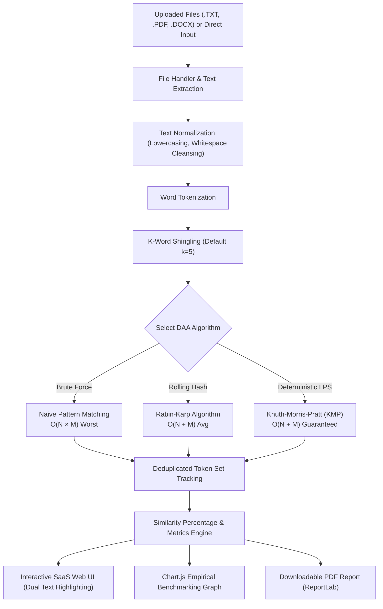

# 🛡️ PlagScan — Intelligent Plagiarism Detection System
### Design and Analysis of Algorithms (DAA) Capstone Project


> **Student / Author:** Pulkit Bhardwaj (`Pulkit-X-exe`)  
> **Repository:** [https://github.com/Pulkit-X-exe/DAA_CAPSTONE](https://github.com/Pulkit-X-exe/DAA_CAPSTONE)  
> **Course:** Design and Analysis of Algorithms (DAA) — Capstone Project  

---

## 📌 Executive Summary

**PlagScan** is a plagiarism and text-overlap detection web and CLI system built to demonstrate and evaluate the efficiency of string-matching algorithms learned in Design and Analysis of Algorithms (DAA).

The system compares two text documents (Reference Document vs. Suspect Document) and identifies similar or matching text using three manually implemented string-matching algorithms:
1. **Naive Pattern Matching**
2. **Rabin-Karp Algorithm (Rolling Hash)**
3. **Knuth-Morris-Pratt (KMP) Algorithm (LPS Array)**

> **Important Academic Note:** PlagScan detects text overlap, verbatim borrowing, and syntactic similarity. It does not claim to detect semantic paraphrasing, translation plagiarism, or AI-generated content.

---

## 🏗️ System Architecture & Workflow



---

## 📊 Theoretical Complexity Comparison

| Algorithm | Preprocessing Time | Best Case Time | Average Case Time | Worst Case Time | Auxiliary Space | Text Backtracking? |
| :--- | :---: | :---: | :---: | :---: | :---: | :---: |
| **Naive Pattern Matching** | $O(1)$ (None) | $O(N)$ | $O(N)$ | $O(N \times M)$ | $O(1)$ | **Yes** (resets index) |
| **Rabin-Karp Rolling Hash** | $O(M)$ | $O(N + M)$ | $O(N + M)$ | $O(N \times M)$ | $O(1)$ | **No** (slides window) |
| **Knuth-Morris-Pratt (KMP)** | $O(M)$ (LPS) | $O(N)$ | $O(N)$ | $O(N + M)$ | $O(M)$ | **Strictly No** |

*(Where $N$ is the total length of the reference text and $M$ is the length of the query pattern/shingle).*

---

## ⚡ Empirical Benchmark Results

Benchmarking conducted on identical inputs using `time.perf_counter()` (excluding preprocessing):

| Scenario | Input Size ($N$) | Pattern Size ($M$) | Naive Time | Rabin-Karp Time | KMP Time | KMP Speedup vs Naive |
| :--- | :---: | :---: | :---: | :---: | :---: | :---: |
| **Small Natural Text** | 1,000 chars | 20 chars | 0.25 ms | 0.33 ms | 0.20 ms | **1.25x** |
| **Medium Natural Text** | 10,000 chars | 18 chars | 2.45 ms | 3.34 ms | 1.67 ms | **1.47x** |
| **Large Natural Text** | 30,000 chars | 21 chars | 7.36 ms | 10.09 ms | 5.14 ms | **1.43x** |
| **Pathological Worst-Case** (`'A'*5000 + 'B'`) | 5,001 chars | 101 chars | **43.68 ms** | **1.65 ms** | **1.02 ms** | **42.92x Faster** |

---

## 🧮 Similarity Calculation Formula

PlagScan avoids artificial score inflation from overlapping shingles by computing a mathematical token set:

$$\text{Similarity \%} = \min\left(100.0, \frac{|\text{Unique Matched Words in Compared Doc}|}{\text{Total Words in Compared Doc}} \times 100\right)$$

- Shingles of $k$ consecutive words (default $k=5$) are matched against the reference text.
- Matched token indices are recorded into a disjoint Python `set()`.
- Overlapping shingles never double-count the same word.

---

## 🚀 Installation & Running

### Prerequisites
- Python 3.10 or 3.11 installed
- Git installed

### 1. Clone the Repository
```bash
git clone https://github.com/Pulkit-X-exe/DAA_CAPSTONE.git
cd DAA_CAPSTONE
```

### 2. Install Required Dependencies
```bash
pip install -r requirements.txt
```

### 3. Run Automated Tests (63 tests)
```bash
python -m pytest tests/ -v
```

### 4. Run the Web Application
```bash
python app.py
```
Open your browser and navigate to:  
👉 `http://127.0.0.1:5000`

### 5. Run the CLI Tool
```bash
python cli.py --doc1 samples/original_computer_science.txt --doc2 samples/plagiarized_computer_science.txt --algo kmp --benchmark
```

### 6. Run the Standalone Benchmark Stress Tester
```bash
python benchmark.py
```

---

## 📁 Project Directory Structure

```
DAA_CAPSTONE/
├── app.py                      # Flask Application controller and routes
├── config.py                   # App configuration and limits
├── cli.py                      # Command Line Interface (CLI) runner
├── benchmark.py                # Standalone asymptotic stress test suite
├── requirements.txt            # Python dependencies
├── VIVA_PREPARATION.md         # Comprehensive viva oral exam guide
├── README.md                   # Complete project documentation
│
├── algorithms/                 # Pure manual DAA string matching algorithms
│   ├── __init__.py
│   ├── base.py                 # Abstract base class and MatchResult dataclass
│   ├── naive.py                # Naive pattern matching O(N*M)
│   ├── rabin_karp.py           # Rabin-Karp rolling hash O(N+M)
│   └── kmp.py                  # Knuth-Morris-Pratt O(N+M)
│
├── utils/                      # Core mathematical & file utilities
│   ├── __init__.py
│   ├── text_processing.py      # Normalization, tokenization, shingling
│   ├── similarity.py           # Containment similarity and safe HTML highlighter
│   ├── jaccard.py              # Jaccard and Overlap set metrics
│   ├── file_handler.py         # File extraction (TXT, PDF, DOCX) & sanitization
│   └── report_generator.py     # PDF ReportLab document generator
│
├── services/                   # Business logic orchestration
│   ├── __init__.py
│   ├── comparison_service.py   # Primary comparison workflow
│   └── benchmark_service.py    # Multi-algorithm performance timer
│
├── templates/                  # Jinja2 HTML5 Templates
│   ├── base.html               # Master layout, navigation, and DAA modal
│   ├── index.html              # Homepage with drag-and-drop & preset buttons
│   └── result.html             # Results dashboard with dual highlighting & Chart.js
│
├── static/                     # Assets
│   ├── css/style.css           # Premium dark navy SaaS styling
│   └── js/script.js            # Drag-and-drop, sample loader, Chart.js logic
│
├── samples/                    # Sample documents for evaluation
│   ├── original_computer_science.txt
│   ├── plagiarized_computer_science.txt
│   ├── quantum_computing_article.txt
│   └── biology_photosynthesis.txt
│
└── tests/                      # Pytest automated test suite (63 tests)
    ├── test_naive.py
    ├── test_rabin_karp.py
    ├── test_kmp.py
    ├── test_algorithm_stats.py
    ├── test_similarity.py
    ├── test_text_processing.py
    ├── test_jaccard.py
    ├── test_file_handler.py
    ├── test_app.py
    ├── test_cli.py
    ├── test_report.py
    └── test_edge_cases.py
```

---

## 🎯 Viva Quick Access
Review `VIVA_PREPARATION.md` for answers to 25+ viva questions, including:
- LPS array manual construction for string `"ABABC"`
- Rolling hash mathematical transitions
- Spurious hits and hash collision handling
- Why KMP guarantees $O(N + M)$ without backtracking
- English + Hinglish conceptual summary
